# 440 Templates

Combined VU Meter + Spectrum templates (self-contained with both parts).

---

## 1920x440_Aluminium_spectrum

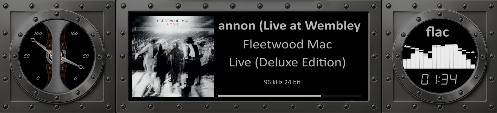

| Property | Value |
|----------|-------|
| Meter Name | Aluminium_spectrum |
| Meter Type | circular |
| Extended Config | Yes |
| Spectrum | Yes |
| Album Art | Yes |

**Download:** [1920x440_Aluminium_spectrum.zip](1920x440_Aluminium_spectrum.zip)

**Install (both required):**
1. Extract the zip file
2. Copy `templates/` contents to `/data/INTERNAL/glass/templates/`
3. Copy `templates_spectrum/` contents to `/data/INTERNAL/glass/templates_spectrum/`

Or press Install on the Catalog tab of the Glass Manager.

---

## 1920x440_BB_5

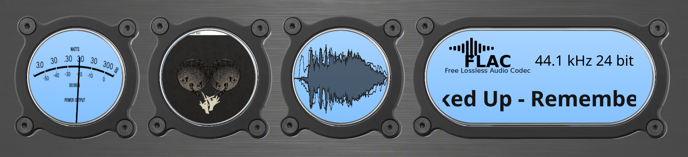

| Property | Value |
|----------|-------|
| Meter Name | BB_5_spectrum |
| Meter Type | linear |
| Extended Config | Yes |
| Spectrum | Yes |
| Album Art | Yes |

**Download:** [1920x440_BB_5.zip](1920x440_BB_5.zip)

**Uses the spectrum analyser.**

**Install (both required):**
1. Extract the zip file
2. Copy `templates/` contents to `/data/INTERNAL/glass/templates/`
3. Copy `templates_spectrum/` contents to `/data/INTERNAL/glass/templates_spectrum/`

Or press Install on the Catalog tab of the Glass Manager.

---

## 1920x440_BB_6

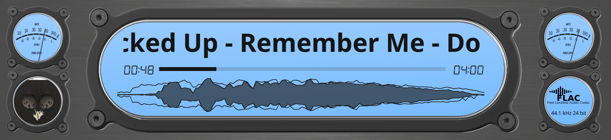

| Property | Value |
|----------|-------|
| Meter Name | BB_5_spectrum |
| Meter Type | linear |
| Extended Config | Yes |
| Spectrum | Yes |
| Album Art | Yes |

**Download:** [1920x440_BB_6.zip](1920x440_BB_6.zip)

**Uses the spectrum analyser.**

**Install (both required):**
1. Extract the zip file
2. Copy `templates/` contents to `/data/INTERNAL/glass/templates/`
3. Copy `templates_spectrum/` contents to `/data/INTERNAL/glass/templates_spectrum/`

Or press Install on the Catalog tab of the Glass Manager.

---

## 1920x440_Black_Blue

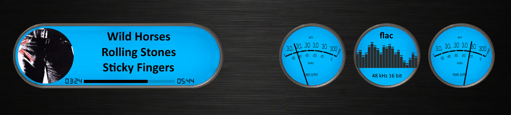

| Property | Value |
|----------|-------|
| Meter Name | Black_Blue_spectrum |
| Meter Type | circular |
| Extended Config | Yes |
| Spectrum | Yes |
| Album Art | Yes |

**Download:** [1920x440_Black_Blue.zip](1920x440_Black_Blue.zip)

**Install (both required):**
1. Extract the zip file
2. Copy `templates/` contents to `/data/INTERNAL/glass/templates/`
3. Copy `templates_spectrum/` contents to `/data/INTERNAL/glass/templates_spectrum/`

Or press Install on the Catalog tab of the Glass Manager.

---

## 1920x440_Black_Blue_2

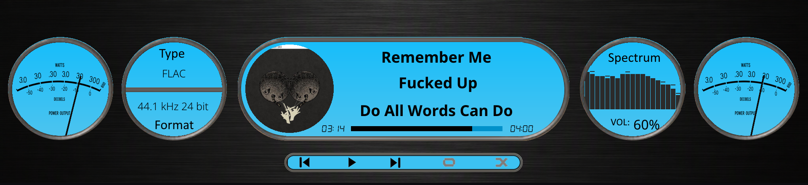

| Property | Value |
|----------|-------|
| Meter Name | Black_Blue_2_spectrum |
| Meter Type | circular |
| Extended Config | Yes |
| Spectrum | Yes |
| Album Art | Yes |

**Download:** [1920x440_Black_Blue_2.zip](1920x440_Black_Blue_2.zip)

**Install (both required):**
1. Extract the zip file
2. Copy `templates/` contents to `/data/INTERNAL/glass/templates/`
3. Copy `templates_spectrum/` contents to `/data/INTERNAL/glass/templates_spectrum/`

Or press Install on the Catalog tab of the Glass Manager.

---

## 1920x440_Black_Blue_3

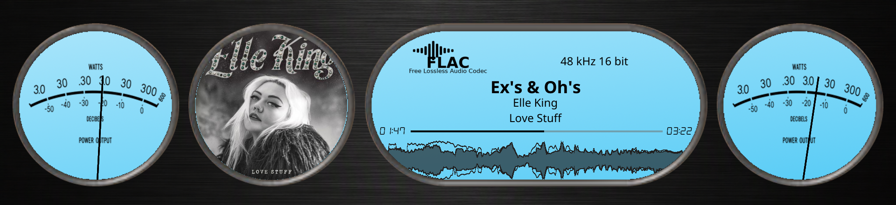

| Property | Value |
|----------|-------|
| Meter Name | Black_Blue_3_spectrum |
| Meter Type | circular |
| Extended Config | Yes |
| Spectrum | Yes |
| Album Art | Yes |

**Download:** [1920x440_Black_Blue_3.zip](1920x440_Black_Blue_3.zip)

**Uses the spectrum analyser.**

**Install (both required):**
1. Extract the zip file
2. Copy `templates/` contents to `/data/INTERNAL/glass/templates/`
3. Copy `templates_spectrum/` contents to `/data/INTERNAL/glass/templates_spectrum/`

Or press Install on the Catalog tab of the Glass Manager.

---

## 1920x440_Black_Blue_4

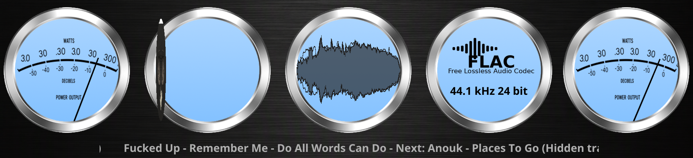

| Property | Value |
|----------|-------|
| Meter Name | Black_Blue_4_spectrum |
| Meter Type | circular |
| Extended Config | Yes |
| Spectrum | Yes |
| Album Art | Yes |

**Download:** [1920x440_Black_Blue_4.zip](1920x440_Black_Blue_4.zip)

**Uses the spectrum analyser.**

**Install (both required):**
1. Extract the zip file
2. Copy `templates/` contents to `/data/INTERNAL/glass/templates/`
3. Copy `templates_spectrum/` contents to `/data/INTERNAL/glass/templates_spectrum/`

Or press Install on the Catalog tab of the Glass Manager.

---

## 1920x440_Flow_Two

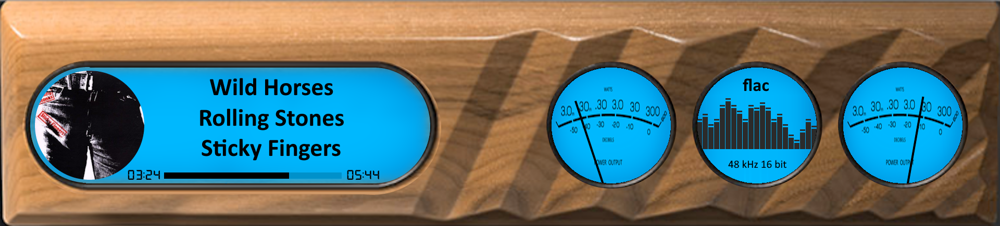

| Property | Value |
|----------|-------|
| Meter Name | Flow_Two |
| Meter Type | circular |
| Extended Config | Yes |
| Spectrum | Yes |
| Album Art | Yes |

**Download:** [1920x440_Flow_Two.zip](1920x440_Flow_Two.zip)

**Install (both required):**
1. Extract the zip file
2. Copy `templates/` contents to `/data/INTERNAL/glass/templates/`
3. Copy `templates_spectrum/` contents to `/data/INTERNAL/glass/templates_spectrum/`

Or press Install on the Catalog tab of the Glass Manager.

---

## 1920x440_Naim_NSS-333

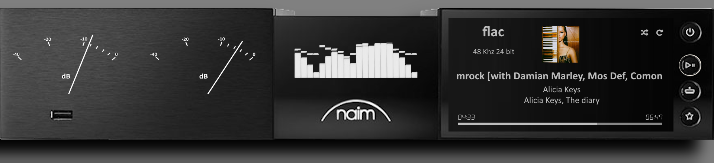

| Property | Value |
|----------|-------|
| Meter Name | Naim_NSS-333 |
| Meter Type | circular |
| Extended Config | Yes |
| Spectrum | Yes |
| Album Art | Yes |

**Download:** [1920x440_Naim_NSS-333.zip](1920x440_Naim_NSS-333.zip)

**Install (both required):**
1. Extract the zip file
2. Copy `templates/` contents to `/data/INTERNAL/glass/templates/`
3. Copy `templates_spectrum/` contents to `/data/INTERNAL/glass/templates_spectrum/`

Or press Install on the Catalog tab of the Glass Manager.

---

## 1920x440_Project_VTER

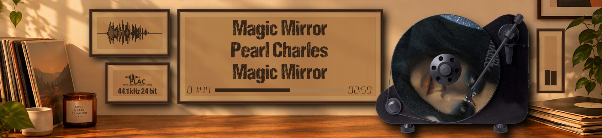

| Property | Value |
|----------|-------|
| Meter Name | vertical-turntable-blue |
| Meter Type | linear |
| Extended Config | Yes |
| Spectrum | Yes |
| Album Art | Yes |

**Download:** [1920x440_Project_VTER.zip](1920x440_Project_VTER.zip)

**Uses the spectrum analyser.**

**Install (both required):**
1. Extract the zip file
2. Copy `templates/` contents to `/data/INTERNAL/glass/templates/`
3. Copy `templates_spectrum/` contents to `/data/INTERNAL/glass/templates_spectrum/`

Or press Install on the Catalog tab of the Glass Manager.

---

## 1920x440_Signature12_2

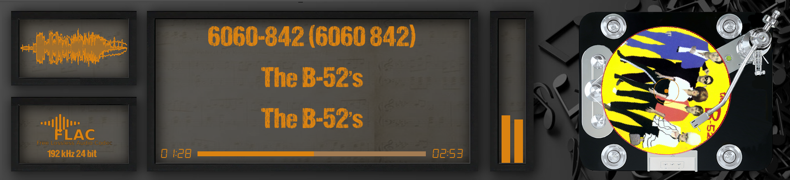

| Property | Value |
|----------|-------|
| Meter Name | 1920x440_Signature12_2 |
| Meter Type | linear |
| Extended Config | Yes |
| Spectrum | Yes |
| Album Art | Yes |

**Download:** [1920x440_Signature12_2.zip](1920x440_Signature12_2.zip)

**Uses the spectrum analyser.**

**Install (both required):**
1. Extract the zip file
2. Copy `templates/` contents to `/data/INTERNAL/glass/templates/`
3. Copy `templates_spectrum/` contents to `/data/INTERNAL/glass/templates_spectrum/`

Or press Install on the Catalog tab of the Glass Manager.

---

## 1920x440_Titanium_Black

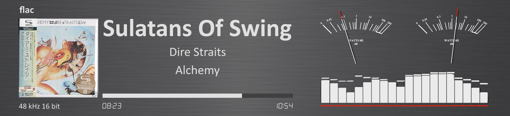

| Property | Value |
|----------|-------|
| Meter Name | Titanium_Black |
| Meter Type | circular |
| Extended Config | Yes |
| Spectrum | Yes |
| Album Art | Yes |

**Download:** [1920x440_Titanium_Black.zip](1920x440_Titanium_Black.zip)

**Install (both required):**
1. Extract the zip file
2. Copy `templates/` contents to `/data/INTERNAL/glass/templates/`
3. Copy `templates_spectrum/` contents to `/data/INTERNAL/glass/templates_spectrum/`

Or press Install on the Catalog tab of the Glass Manager.

---

## 1920x440_black-anodized

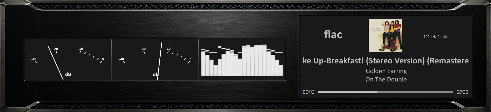

| Property | Value |
|----------|-------|
| Meter Name | Black-Anodized |
| Meter Type | circular |
| Extended Config | Yes |
| Spectrum | Yes |
| Album Art | Yes |

**Download:** [1920x440_black-anodized.zip](1920x440_black-anodized.zip)

**Install (both required):**
1. Extract the zip file
2. Copy `templates/` contents to `/data/INTERNAL/glass/templates/`
3. Copy `templates_spectrum/` contents to `/data/INTERNAL/glass/templates_spectrum/`

Or press Install on the Catalog tab of the Glass Manager.

---

## 1920x440_vertical_01

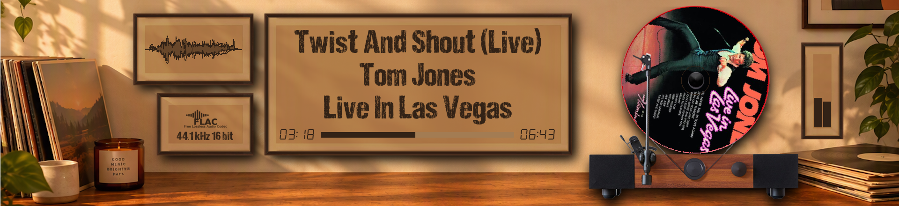

| Property | Value |
|----------|-------|
| Meter Name | vertical-turntable-blue |
| Meter Type | linear |
| Extended Config | Yes |
| Spectrum | Yes |
| Album Art | Yes |

**Download:** [1920x440_vertical_01.zip](1920x440_vertical_01.zip)

**Uses the spectrum analyser.**

**Install (both required):**
1. Extract the zip file
2. Copy `templates/` contents to `/data/INTERNAL/glass/templates/`
3. Copy `templates_spectrum/` contents to `/data/INTERNAL/glass/templates_spectrum/`

Or press Install on the Catalog tab of the Glass Manager.

---

## Installation

1. Download the desired template zip(s)
2. Extract each to the path shown next to its download link
3. Choose it on the Themes tab of the Glass Manager

---

*Part of the [Glass theme collection](https://github.com/foonerd/glass_templates)*
